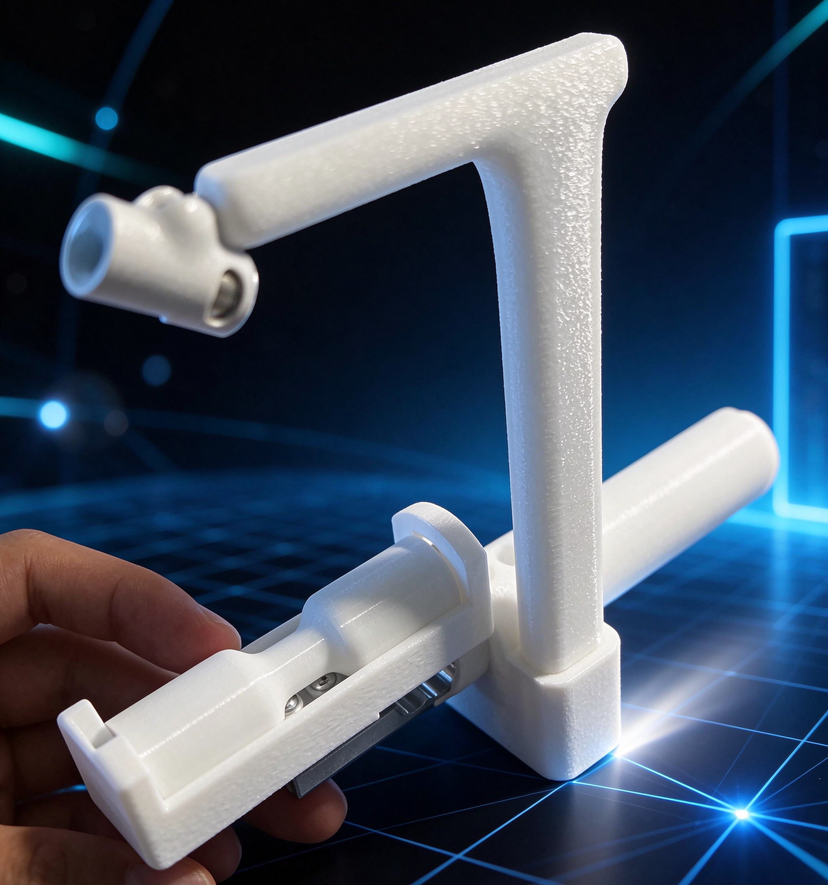
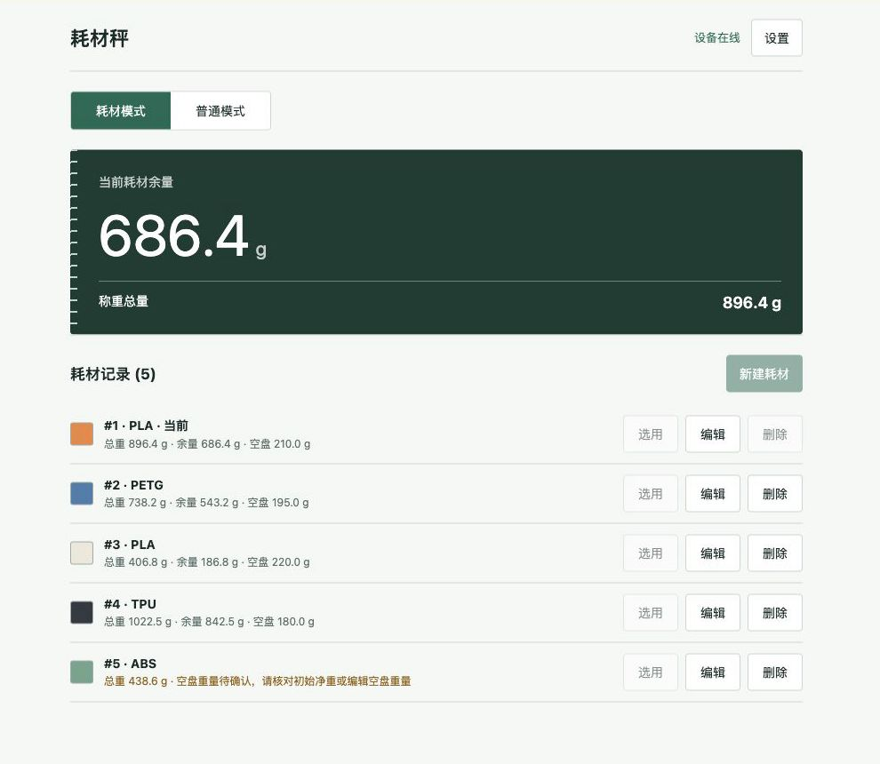
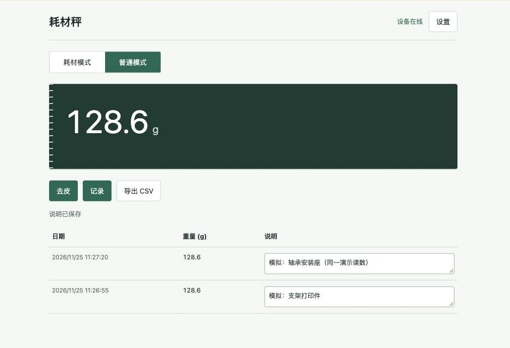
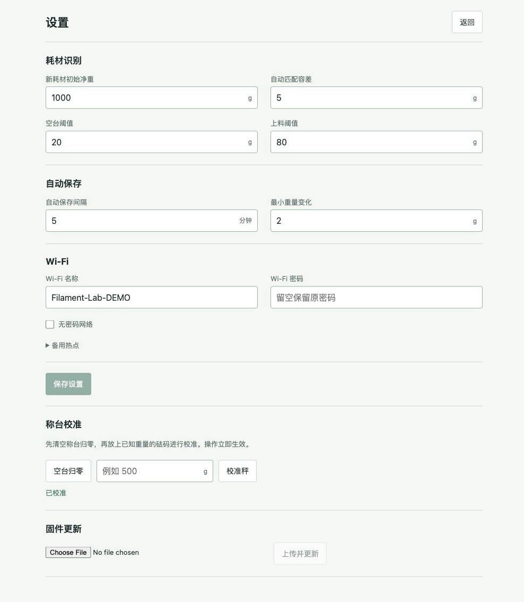
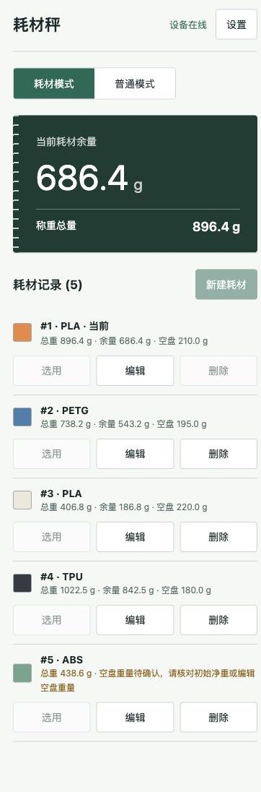

# Filament Storekeeper · 耗材管家

**让耗材支架不只托住料盘，还能告诉你剩下多少料。**

基于 **ESP32-C3 + HX711** 的本地网页耗材秤。将称重结构与耗材支架结合，在正常供料的同时查看重量和估算余量；用手机或电脑浏览器管理耗材，不必为了检查重量反复拆卷，也不需要额外部署服务器。

[3D 打印模型](https://makerworld.com.cn/models/3293766) · [实物展示](#实物展示) · [页面预览](#页面预览) · [开始使用](#开始使用) · [接口速查](#接口速查) · [MIT License](LICENSE)

## 实物展示

耗材支架实物展示：将支撑结构、轴承滚轮与称重结构结合，利用原有耗材架位置完成称重。



[下载 3D 打印模型与查看装配说明](https://makerworld.com.cn/models/3293766)

## 为什么做这个项目

打印前想知道半卷耗材够不够，通常需要取下料卷称重，再扣除空盘重量。独立电子秤还会占用工作台空间。这个项目把称重放回原本的耗材支架位置：**放上去正常使用，需要时打开网页看余量。**

作者的支架设计按对应原装安装尺寸制作，并加入带滚珠轴承的滚轮。主控使用 ESP32-C3 SuperMini，搭配 HX711 与称重传感器；作者采购口径下核心硬件约 **15 元**，不是包含打印件、轴承、电源、运费在内的统一整机报价。

适合个人工作室、桌面打印机和十几卷耗材交替使用的场景。固件最多保存 **32 卷**耗材档案。

## 能做什么

| 功能 | 当前实现 |
| --- | --- |
| 打印时查看余量 | 显示当前总重量，并在盘重已知时计算剩余耗材；网页周期刷新 |
| 耗材档案 | 记录颜色、材质、空盘重量及已保存的总重；支持 PLA / PETG / ABS / TPU / 其他 |
| 根据重量匹配历史卷 | 上料稳定后，在容差内只有一条候选时自动确认；无需 RFID / NFC 芯片 |
| 新卷盘重估算 | 新建时用稳定总重减去设定的初始净重；盘重可人工修正 |
| 使用量保存 | 已确认卷只按稳定的重量下降更新；满足时间与变化量条件后写入设备，下料时尝试最终保存 |
| 普通称重 | 临时去皮、记录重量与备注、导出 CSV |
| 本地网页 | ESP32 自行提供页面和 API；耗材档案、校准与配置保存在设备 NVS 中 |
| 联网与恢复 | 2.4 GHz Wi-Fi、mDNS 地址、连接失败后的备用热点 |
| 网页维护 | 参数设置、空台归零、砝码校准、上传应用固件 `.bin` |

> **它通过重量匹配，不是读取料卷身份。** 多卷重量接近或没有匹配记录时，需要手动选择或新建。颜色和材质由用户填写，不会自动检测。显示到 0.1 g 不等于具备 0.1 g 的实测精度。

## 页面预览

以下为**当前固件页面源码 + 合成数据**在浏览器中的截图，不是实机测量或精度测试结果。

### 耗材管理

当前橙色 PLA 总重 896.4 g，空盘 210.0 g，余量 686.4 g；历史卷展示材质、颜色和已保存的重量。最后一卷展示“空盘重量待确认”的实际提示。



### 普通称重

记录当前显示重量，填写备注，导出 CSV。**这些日志保存在同一浏览器、同一访问地址的本地存储中**，与设备中的耗材档案不同；刷新会清除临时去皮值，但不会正常清除已有日志。



### 设置与校准

识别容差、上下料门限、保存策略、Wi-Fi、归零、砝码校准和固件更新集中在设置页。截图中的网络名称也是虚构的。



### 手机访问

手机浏览器可以查看当前余量并管理记录，无需安装专用 App。



## 3D 打印模型

**模型下载与装配说明：[MakerWorld · 耗材支架模型](https://makerworld.com.cn/models/3293766)**

先确认模型页面列出的适配机型、安装接口、所需配件和打印要求，再打印、装配。直接替换原装支架是针对对应适配结构的设计目标，不代表所有打印机通用。本仓库提供固件与网页源码，模型由上面的 MakerWorld 页面分发；模型许可和使用条件以该页面为准。

## 硬件与接线

| 部件 | 用途 / 选择说明 |
| --- | --- |
| ESP32-C3 SuperMini | 主控、Wi-Fi 和网页服务；确认所购开发板的实际引脚标注 |
| HX711 模块 | 读取称重传感器信号 |
| 称重传感器 | 按支架结构、最大料卷重量及安全余量选择；本仓库不限定统一量程 |
| 打印支架、轴承、滚轮及紧固件 | 按模型页面配套装配 |
| USB 电源、线材 | 为主控供电并完成首次串口刷写 |
| 按钮（可选） | 耗材稳定且未识别时，新建耗材记录 |
| 已知重量的砝码 | 首次校准及检查称重结果 |

当前固件引脚：

| ESP32-C3 | 连接 |
| --- | --- |
| GPIO6 | HX711 DT / DOUT |
| GPIO7 | HX711 SCK |
| GPIO3 | 按钮的一端，另一端接 GND；内部上拉 |
| GND | HX711 和主控共地 |

传感器接 HX711 的 E+/E−、A+/A−，具体线色和极性按传感器资料确认。供电按所用 HX711 模块规格接线，确保与 ESP32-C3 的 **3.3 V GPIO 电平兼容**，不要直接向 GPIO 输入 5 V。当前固件没有显示屏驱动，不需要接 OLED。

机械装配时确保负载经过传感器的受力路径，避免料盘或支架额外接触其他物体形成旁路。拉丝张力、振动、安装松动和偏载都会影响读数；实际效果需要装好后校准与验证。

## 开始使用

### 1. 准备 Arduino 工程

- 安装 Arduino IDE。
- 安装开发板包 **esp32 by Espressif Systems**；项目历史记录使用过 `3.3.11`。
- 安装 **HX711 by bogde** 库。
- Arduino 草图文件夹必须与主文件同名：**`HX711WebScale/HX711WebScale.ino`**。本 Git 目录名不同，建议复制到同名工作目录后打开；所有根目录 `.ino`、`.h` 要一起保留。

例如，在仓库根目录执行以下命令，复制源码到一个尚不存在的临时构建目录：

```sh
mkdir -p /tmp/filament-storekeeper-build
mkdir /tmp/filament-storekeeper-build/HX711WebScale
cp ./*.ino ./*.h /tmp/filament-storekeeper-build/HX711WebScale/
```

打开复制后的 `HX711WebScale.ino`。按照实际板型选择开发板；SuperMini 可从 **ESP32C3 Dev Module** 配置开始核对 Flash、USB 与引脚设置。历史构建也使用过 `esp32:esp32:XIAO_ESP32C3`，这不代表其配置适用于所有 SuperMini 板。

如需网页 OTA，首次串口烧录必须选用支持 OTA、且应用分区足够的分区方案。串口监视器波特率为 **115200**。

### 2. 配置网络并串口上传

草图中的 `WIFI_SSID` / `WIFI_PASSWORD` 是默认网络配置，设备已经保存的 Wi-Fi 设置会优先使用。请在自己的构建副本中填写网络，或将两者设为空字符串，从备用热点配网。不要把自己的密码提交到公开仓库。

首次使用通过 USB 上传。设备未配置网络时开启 `Scale-xxxxxx` 备用热点；已配置但持续连接失败约 30 秒后也会开启热点。连接热点，打开：

```text
http://192.168.4.1/settings
```

填写 **2.4 GHz Wi-Fi**，保存后让手机或电脑回到同一局域网。通过路由器分配的设备 IP，或支持 mDNS 的环境下访问：

```text
http://scale-xxxxxx.local/
```

`xxxxxx` 是设备标识，请从串口输出、热点名称或路由器中确认。mDNS 不可用时使用 IP 地址。Wi-Fi 恢复并稳定一段时间后备用热点会关闭。

### 3. 空台归零与校准

1. 装好支架，移走待称物，保持空台稳定。
2. 打开设置页，点击“空台归零”。
3. 放上已知重量的砝码，输入实际克数，点击“校准秤”。
4. 取下并重新放置砝码，检查零点与读数，再开始建档。

未校准时不会显示可用克数。重新校准不会重新解释已经以克数保存的历史重量；更换结构或受力方式后，应复核校准与盘重。

### 4. 新建与使用耗材

1. 新整卷上架，等重量稳定后点击“新建耗材”，也可使用 GPIO3 按钮。
2. 编辑颜色、材质及必要的盘重信息。
3. 初始净重默认 1000 g；500 g 或其他规格的新卷，先调整设置再建档。
4. 半卷不要按整卷净重估算盘重，应填入已知的空盘重量。推算结果为负时，新记录会标记“空盘重量待确认”，不会把盘重当成零。
5. 换回旧卷时等待稳定匹配；匹配不唯一时手动“选用”。手动选用会将该记录总重同步为当前稳定总重。

余量计算为 `max(0, 总重 − 空盘重量)`。当前卷使用网页读到的重量，其他卷使用上次保存的数据。普通模式下不做耗材识别或库存使用量更新。

## 常用参数

| 参数 | 默认 | 范围 / 含义 |
| --- | --- | --- |
| 新耗材初始净重 | 1000 g | 100–5000 g；仅用于之后新建记录的盘重估算 |
| 自动匹配容差 | 5 g | 0.5–50 g；容差内只有一条记录才自动确认 |
| 空台阈值 | 20 g | 1–100 g |
| 上料阈值 | 80 g | 不超过 500 g，至少比空台阈值高 20 g |
| 自动保存间隔 | 5 分钟 | 1–120 的整数分钟 |
| 最小重量变化 | 2 g | 0.5–100 g；与时间条件同时满足才周期保存 |

稳定判断使用最近 10 点、约 3 g 波动范围和约 1.5 秒持续稳定；下料需连续约 0.6 秒处于空台范围。网页在每次读数请求结束后等待 3 秒再请求，网络处理可能进一步延迟刷新，这不是高频实时波形显示。

## 固件更新

在 Arduino IDE 导出与实际板型、分区配置一致的应用 `.bin`，进入设置页选择文件并“上传并更新”。请使用**应用固件**，不要上传合并引导镜像。

当前版本不需要长按按钮解锁。写入成功并完成检查后设备才会重启；上传进度走完不等于更新成功，应检查成功提示并等设备重新上线。弱网可能导致中断，需要重试；不能通过网页更新时使用 USB 串口恢复。

当前 HTTP 页面、接口和 OTA 没有完整账户鉴权体系，备用热点为开放热点。适合可信本地网络，不应直接做公网端口映射；设置令牌不能当作整个设备的访问控制。

## 数据与使用边界

- **重量不是身份码：** 相近重量、未及时保存的消耗、在其他设备上使用过的料卷，都可能需要人工选用。
- **余量是估算：** 依赖校准、初始净重及空盘重量。拉力和机械振动也会影响测量。
- **掉电并非逐克无损：** 突然断电可能丢失尚未达到保存条件的消耗。耗材档案、设置和校准正常保存在设备中。
- **普通日志属于浏览器：** 更换浏览器或用 IP / `.local` 不同地址访问，不会自动共享日志；重要记录请导出 CSV。
- **异常不伪装成新读数：** 传感器错误会提示异常；已确认身份可保留，但异常期间不更新使用量。故障期间的物理换卷不能可靠推断。
- **不是完整打印机联动系统：** 当前没有自动读切片所需重量、自动暂停打印、RFID/NFC 读卡或云端同步功能。

## 源码与开发

| 文件 | 职责 |
| --- | --- |
| `HX711WebScale.ino` | 入口、引脚、主循环和 HTTP 路由 |
| `Measurement.ino` / `InventoryLogic.h` | 采样、稳定判断、上下料状态和重量匹配规则 |
| `InventoryApi.ino` / `Storage.ino` | 耗材操作、读数接口和 NVS 存储 |
| `ScalePage.h` / `SettingsPage.h` | 实际网页 HTML、CSS、JavaScript |
| `SettingsApi.ino` / `Network.ino` | 配置、校准、Wi-Fi 和备用热点 |
| `FirmwareUpdate.ino` | 网页固件上传 |
| `WebPages.generated.h` | 生成的压缩网页资源，不应手动修改 |

修改页面后，在仓库根目录生成并检查资源，再复制源码到草图目录编译：

```sh
python3 tools/generate_web_pages.py
python3 tools/generate_web_pages.py --check
```

## 接口速查

接口在设备本地 HTTP 服务上提供，写操作使用表单参数；下表用于理解当前实现，详细校验以对应源码为准。

| 方法 / 路径 | 用途 |
| --- | --- |
| `GET /api/reading` | 返回 `raw,state,id,value`；响应头 `X-Scale-Mode` 确认设备模式 |
| `GET /api/spools` | 获取耗材数组，字段为 `id,material,color,tare,total` |
| `POST /api/spools/create` | 使用当前稳定总重创建并确认耗材 |
| `POST /api/spools/select` | 使用 `id` 选用记录并同步当前稳定总重 |
| `POST /api/spools/update` | 编辑 `id,color,material,tare` |
| `POST /api/spools/delete` | 按 `id` 删除；当前使用或待完成保存的卷不能删除 |
| `POST /api/mode` | `mode=spool` 或 `mode=scale` |
| `GET /api/settings` | 获取配置与设置令牌 |
| `POST /api/settings` | 成组保存参数；需要 `X-Settings-Token` 请求头 |
| `POST /api/base-zero` | 空台归零 |
| `POST /api/calibrate` | 使用 `grams` 参数进行砝码校准 |
| `POST /api/update` | multipart 字段 `firmware` 上传应用 `.bin` |

读数 `state`：`0` 下料、`1` 上料、`99` 未校准、`98` 传感器异常。`id=0` 表示无已确认耗材；异常时可能保留原 ID 和历史计算值，不能把它当作有效的新测量。`tare=null` 表示盘重待确认。

例如，截图对应的合成读数与当前耗材记录：

```json
{"raw":896400,"state":1,"id":1,"value":896.4}
```

```json
{"id":1,"material":0,"color":"#ee8544","tare":210.0,"total":896.4}
```

`raw` 仅为整数，不代表实物校准系数。截图另含 PETG、TPU、ABS 等示例，普通称重固定输入为 128.6 g，Wi-Fi 名称为虚构的 `Filament-Lab-DEMO`。


## 常见问题

**网页打不开？** 先确认设备已启动、客户端与设备在同一网络、Wi-Fi 是 2.4 GHz。优先用路由器显示的 IP；失败时检查串口或连接备用热点。

**有总重却没有余量？** 检查是否已选中耗材、库存列表是否读取成功，以及空盘重量是否已填写。未知盘重不会显示虚假的余量。

**为什么没有自动认出旧卷？** 只有稳定且唯一匹配才会自动确认。查看匹配容差和上次记录，必要时手动选用，不建议盲目扩大容差。

**为什么变更模式失败？** 切换到普通模式前需保存当前耗材的最终消耗；保存失败时设备不会宣称切换成功。先检查错误提示，恢复后重试。

**能否直接用于我的打印机？** 固件面向 ESP32-C3 + HX711，但机械替换还取决于安装接口、料卷规格和受力结构，请先查看 [模型页面](https://makerworld.com.cn/models/3293766)。

## License

本仓库原创软件采用 [MIT License](LICENSE)，允许使用、复制、修改、分发和商业使用，需保留版权声明与许可文本；软件按“原样”提供，不附带保证。

依赖库保留各自许可证。外部 [3D 打印模型](https://makerworld.com.cn/models/3293766) 的许可独立，以 MakerWorld 模型页面标注为准，本仓库 MIT 许可不自动覆盖该模型。
